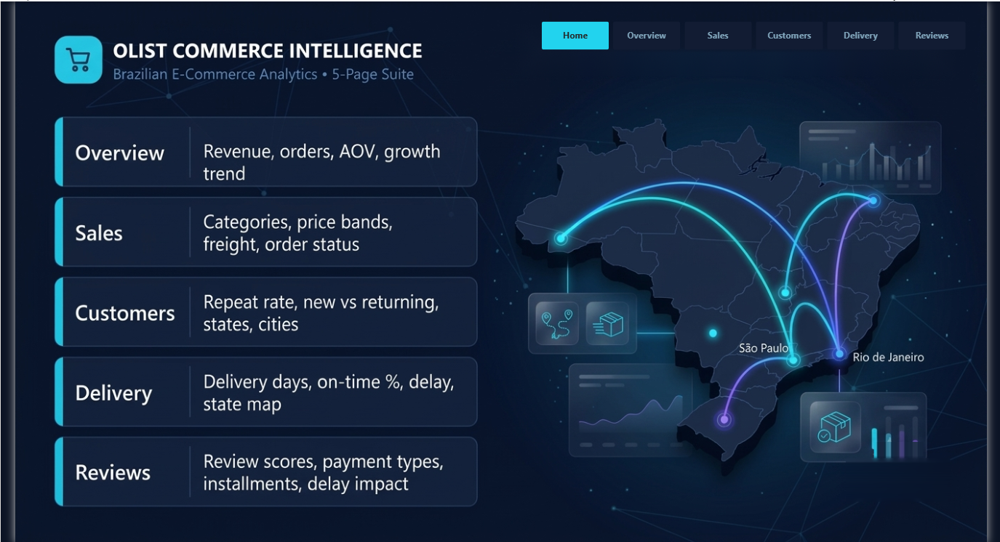
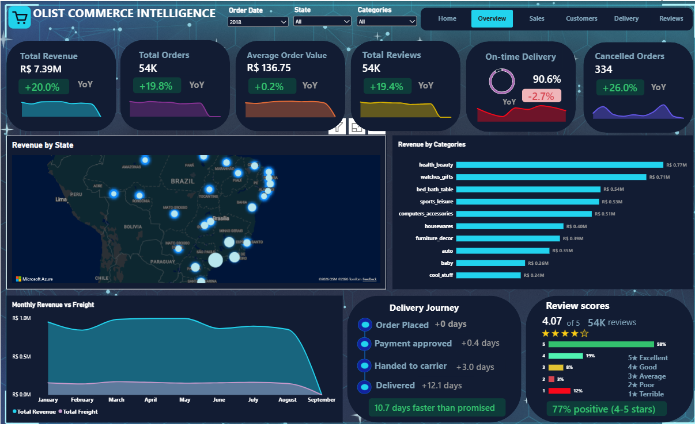
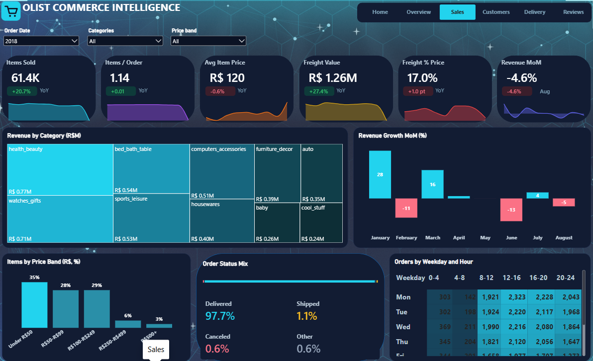
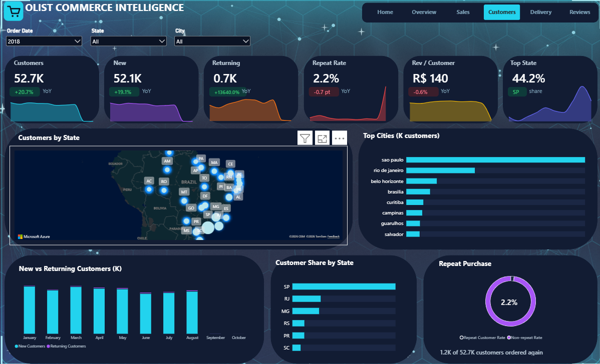
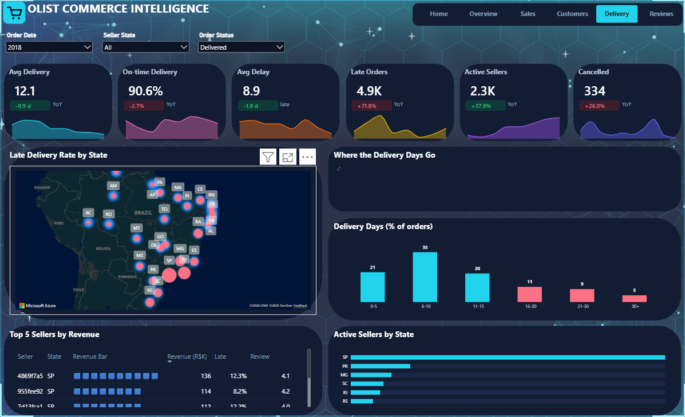
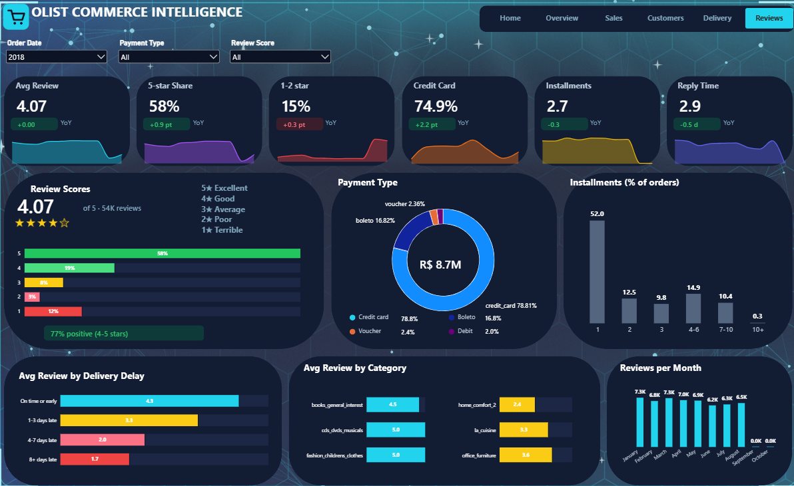

# End-to-End E-Commerce Data Analytics & Modeling (Olist Dataset)
> 🛠️ **Looking for the data pipeline behind this dashboard?**  
> The data is cleaned, modeled and tested with **SQL + dbt + DuckDB** and exported to Parquet files that this report reads.  
> 👉 **[Olist Data Pipeline – SQL / dbt](https://github.com/buianhkiet110703/-SQL-_dbt_data_pipeline)**
## 1. Project Context & Dataset Overview
### A. Project Objective
This project aims to build an end-to-end Data Analytics and Engineering portfolio project using the Brazilian E-Commerce Public Dataset by Olist. The primary goal is to transform raw relational CSV files into a structured dimensional model (Star Schema), implement data processing, and design an interactive Power BI dashboard to showcase data modeling and business intelligence skills for a professional CV/GitHub portfolio.
### B. Dataset Description & Table Contents

The dataset comprises 9 core CSV files detailing a multi-seller e-commerce marketplace operation:

-olist_orders_dataset.csv: Contains core order lifecycle metrics, including order status, purchase timestamps, approval dates, carrier delivery dates, actual customer delivery dates, and estimated delivery dates. (Acts as the core event log)

olist_order_items_dataset.csv: Records line-item details for each order, including item sequence ID, product ID, seller ID, shipping limit date, item price, and freight value.

-olist_order_payments_dataset.csv: Captures payment information such as payment sequential, payment type (credit card, boleto, voucher, debit card), number of installments, and payment value.

olist_order_reviews_dataset.csv: Stores customer satisfaction metrics, including review ID, review score (1–5 stars), review comment title, message, creation date, and answer timestamp.

-olist_customers_dataset.csv: Contains customer profile data, including unique customer IDs, customer city, state, and zip code prefixes.

-olist_products_dataset.csv: Details product characteristics, such as category name, name length, description length, photo quantity, weight, and physical dimensions (length, height, width).

-olist_sellers_dataset.csv: Lists third-party marketplace sellers, including seller IDs, cities, states, and zip code prefixes.

-olist_geolocation_dataset.csv: Maps zip code prefixes to geographic coordinates (latitude and longitude), city, and state names for spatial analysis.

-product_category_name_translation.csv: Translates product category names from Portuguese to English for reporting readability.

## 2. Data Modeling in Power BI (Star Schema Architecture)
To optimize query performance, eliminate data redundancy, and ensure seamless DAX measure calculations, the dataset is structured into a classic Star Schema with clearly separated Fact Tables (transactional events) and Dimension Tables (descriptive context).

## 3. KPI Definitions

The report tracks the metrics below, grouped by business domain. Every headline KPI is paired with a prior-year comparison so each card shows both the current figure and its year-over-year movement.

### A. Sales & Revenue

| KPI | What it measures |
|---|---|
| Total Revenue | Total value of goods sold, excluding freight |
| Total Orders | Number of distinct orders placed |
| Average Order Value | Average revenue generated per order |
| Items Sold | Total number of individual line items sold |
| Items per Order | Average basket size, in items |
| Avg Item Price | Average selling price of a single item |
| Total Freight | Total shipping cost charged across all orders |
| Freight % of Price | Share of freight in total revenue — how heavily shipping weighs on the basket |
| Revenue Growth MoM / YoY | Revenue movement against the previous month and the previous year |
| Price Band Distribution | How items spread across price tiers: under R$50, R$50–99, R$100–249, R$250–499, R$500+ |
| Order Status Mix | Share of orders that are delivered, shipped, cancelled or other |
| Cancel Rate | Share of orders cancelled before fulfilment |
| Orders by Weekday and Hour | When customers buy, across the week and the day |

### B. Customers

| KPI | What it measures |
|---|---|
| Unique Customers | Number of distinct individuals who placed an order |
| New Customers | Customers making their first-ever purchase in the selected period |
| Returning Customers | Customers who had already bought before the selected period |
| Repeat Customer Rate | Share of customers who placed more than one order — the loyalty signal |
| Revenue per Customer | Average revenue generated per individual customer |
| Top State | The state contributing the largest share of the customer base |
| Customers by State | Geographic spread of the customer base across Brazil |
| Top Cities | Cities with the highest customer counts |
| New vs Returning by Month | Monthly split between first-time and repeat buyers |

### C. Delivery & Logistics

| KPI | What it measures |
|---|---|
| Average Delivery Days | Days from purchase to the parcel reaching the customer |
| On-time Delivery % | Share of orders delivered on or before the promised date |
| Average Delay Days | For late orders only, how many days past the promise they arrived |
| Late Orders | Count of orders that missed the promised delivery date |
| Approval Time | Days from purchase to payment approval |
| Carrier Handoff Time | Days from approval to the parcel reaching the carrier |
| Transit Time | Days from carrier pickup to customer delivery |
| Delivery Days Distribution | Share of orders delivered within 0–5, 6–10, 11–15, 16–20, 21–30 and 30+ days |
| Late Delivery Rate by State | Which regions suffer the most delays |
| Cancelled Orders | Orders cancelled, tracked independently of the delivery status filter |

### D. Sellers

| KPI | What it measures |
|---|---|
| Active Sellers | Number of distinct sellers with at least one sale |
| Revenue per Seller | Average revenue generated per active seller |
| Seller Late Delivery Rate | Share of a seller's orders that arrived late — a fulfilment quality signal |
| Average Seller Review Score | Mean customer rating across a seller's orders |
| Top Sellers by Revenue | The highest-grossing sellers, with their late rate and review score alongside |
| Active Sellers by State | Where the seller base is concentrated |

### E. Payments

| KPI | What it measures |
|---|---|
| Payment Value | Total amount paid, including freight and instalment interest |
| Payment Type Mix | Split across credit card, boleto, voucher and debit card |
| Credit Card Share | Share of transactions settled by credit card |
| Average Instalments | Average number of instalments customers choose |
| Instalments Distribution | Share of payments at 1, 2, 3, 4–6, 7–10 and 10+ instalments |

### F. Reviews

| KPI | What it measures |
|---|---|
| Average Review Score | Mean customer rating, on a 1 to 5 scale |
| Total Reviews | Number of reviews left by customers |
| Review Score Distribution | Share of reviews at each star level |
| 5-star Share | Share of reviews rated 5 stars |
| 1–2 star Share | Share of reviews rated 1 or 2 stars — the dissatisfaction signal |
| Positive Review Share | Share of reviews rated 4 or 5 stars |
| Review Response Time | Days between a review being written and being answered |
| Average Review by Category | Which product categories satisfy customers and which disappoint |
| Review Score by Delivery Delay | How satisfaction falls as delivery runs later — the link between logistics and sentiment |

## 4. Report Pages

The report is a six-page suite sharing one dark theme, with a page navigator in the top-right corner of every page so any page is one click away.

### Home

A visual index of the report. Each of the five cards navigates to its section.

### Overview

The marketplace at a glance: revenue, orders, average order value, review volume, on-time delivery and cancellations, with a revenue map by state, the leading product categories, the monthly revenue-versus-freight trend, the delivery journey broken into stages, and the review score distribution.

### Sales

Product-side analysis: items sold, basket size, average item price, freight cost and freight ratio, with revenue by category as a treemap, month-over-month revenue movement, price-band distribution, order status mix, and a weekday-by-hour purchase heatmap.

### Customers

Customer base and loyalty: unique customers, new versus returning, repeat purchase rate, revenue per customer and the leading state, with a bubble map by state, the top cities, the monthly new-versus-returning split, customer share by state, and a repeat-purchase donut.

### Delivery

Fulfilment performance: average delivery days, on-time percentage, average delay, late orders, active sellers and cancellations, with a late-delivery map by state, the delivery-day distribution, the top five sellers by revenue alongside their late rate and review score, and active sellers by state.

### Reviews

Satisfaction and payments: average review score, 5-star and 1–2-star shares, credit-card share, average instalments and review reply time, with the review score distribution, a payment-type donut, an instalments histogram, review score by delivery delay, average review by category, and review volume by month.

